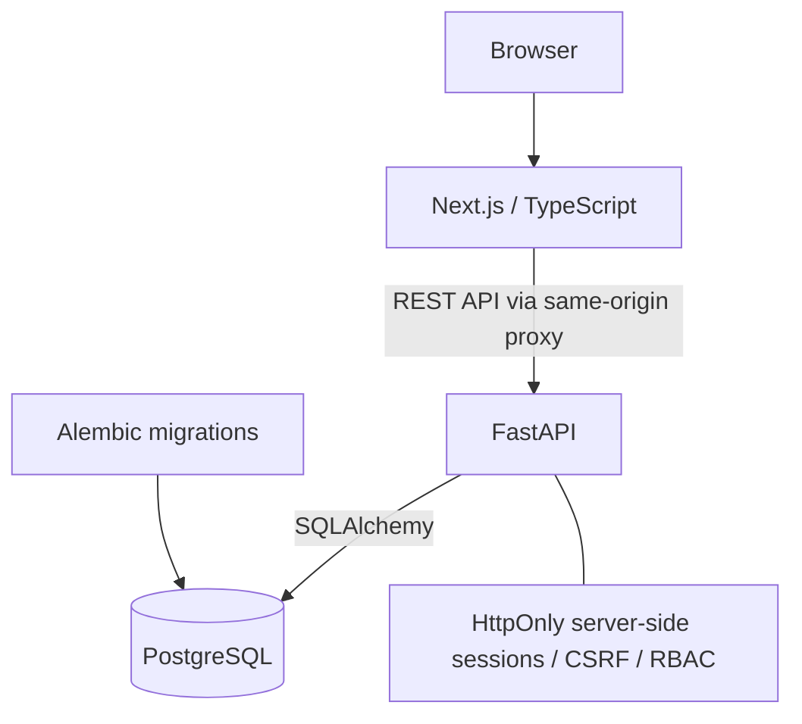

# AXIOM

**Interactive Teaching and Learning Support Platform for Discrete Mathematics I**

AXIOM brings structured question authoring, quiz practice and student progress
into one course workspace. It helps teaching staff reuse mathematical problems
and gives students a place to practise, review solutions and follow their activity.

Developed by **Toghrul Hasanli** as an academic internship software project in the
context of ELTE Faculty of Informatics and Discrete Mathematics I. This is not an
official ELTE production system and does not imply institutional endorsement.

## Status

AXIOM is reported by its owner as deployed as a working academic internship project.
Documentation was checked against repository source on 28 October 2026; live
hosting configuration and availability were not inspected during this handover.

- **Frontend:** https://axiom-orcin-xi.vercel.app/
- **Backend:** https://axiom-api-te6o.onrender.com/
- **Database:** PostgreSQL hosted on Neon.
- **Database migrations:** Source head is `0012`; the owner reports this as the latest verified deployed revision.
- **Historical backend verification:** 242 tests passed, including PostgreSQL integration tests (owner-reported; not rerun for this documentation review).

Implemented functionality includes structured question management, student quizzes,
progress analytics, role-based authentication, email verification, manual grading,
assessment configuration, event and room management, and LaTeX/PDF generation.

AXIOM remains an academic internship project and is not an officially endorsed
ELTE production system.

## Features and roles

### Implemented features

- **Question Bank:** Structured questions, topics, skills, response types and mathematical input.
- **Student quizzes:** Quiz attempts, saved answers, automatic grading of supported objective questions, results and solution review.
- **Student progress:** Personal progress analytics, topic performance and completed attempt history.
- **Authentication:** Registration, email verification, secure server-side sessions and role-based access control.
- **Manual grading:** Staff review and grading of supported written responses.
- **Assessment management:** Assessment configurations, policies, events and room management.
- **LaTeX/PDF generation:** Assessment document preview and PDF generation.

### User roles

| Role         | Responsibilities                                                      |
| ------------ | --------------------------------------------------------------------- |
| Student      | Complete quizzes, review results and track personal progress          |
| Demonstrator | Manage teaching resources and perform permitted grading tasks         |
| Lecturer     | Manage teaching resources, assessments and permitted staff operations |
| Admin        | Administrative account management and authorized teaching operations  |

Public registration requires an exact `@inf.elte.hu` address and email verification;
it creates Student accounts only. Access to protected
operations is enforced by the backend.

Objective answers can be graded automatically when supported by their question
type. Written responses require staff review where manual grading is applicable.

## Handover documentation

- [Lecturer user guide](docs/user-guide.md): actual navigation and supported workflows.
- [Developer handover](docs/developer-handover.md): architecture, setup and maintenance.
- [Production deployment](docs/production-deployment.md): environment, GHCR, migrations and rollback.
- [Final project handover](docs/final-handover.md): evidence, limitations and ownership decisions.

Assessment Documents provides seven templates, a live Draft Preview and real PDF
downloads. Preview includes unsaved edits; Download PDF requires relevant sections
to be saved. General LaTeX / PDF Tools and Exam Builder remain placeholders.

## Screenshots

Screenshots are not yet included. Planned portfolio captures:

- Student Dashboard and Progress page
- Question Bank and Quiz Management
- Quiz attempt and completed review

Use synthetic course content and hide personal account details before adding images.

## Architecture



The browser uses the existing authenticated API client; FastAPI enforces ownership
and permissions. PostgreSQL stores users, course resources and attempt snapshots.
Progress is calculated from submitted attempt data, not mutable question records.

**Stack:** Next.js, TypeScript, Tailwind CSS and shared CSS; FastAPI, PostgreSQL,
SQLAlchemy, Psycopg and Alembic. Passwords use Argon2id hashing.

## Implemented milestones

| Milestone | Scope                                                                             |
| --------- | --------------------------------------------------------------------------------- |
| M1-M2     | Backend foundation, PostgreSQL, Question CRUD and frontend workspace              |
| M3        | Structured Question Bank, topics, response types and skills                       |
| M4 / M4.1 | Student quizzes, saved attempts, results and mathematical input                   |
| M5        | Authentication, roles and access control                                          |
| M6A / M6B | Student progress analytics and frontend                                           |
| M7        | Manual grading and local demonstration                                            |
| M8        | Email verification, account management and email delivery                         |
| M9        | Assessment configuration, event/room management, LaTeX preview and PDF generation |

See the `docs/` directory for milestone architecture, implementation and
verification notes. Earlier documents preserve the project's development
history and may describe functionality that was incomplete at that time.

## Repository structure

```text
backend/
  app/          Models, schemas, routes, services and explicit local scripts
  alembic/      Versioned schema migrations
  tests/        Unit and PostgreSQL integration tests
frontend/
  src/app/      Next.js routes and shared styles
  src/components/  Course, quiz, authentication and progress UI
  src/lib/      Typed API clients and frontend utilities
docs/           Architecture and milestone verification notes
```

## Local development

Prerequisites: Python 3.11+, PostgreSQL (verified locally with 18), Node.js 20.9+
and pnpm (version specified in `frontend/package.json`). The commands below use
PowerShell; on other systems use `.venv/bin/python` instead.

Create a local PostgreSQL role and database; the example configuration uses
`dmi_app` and `dmi_platform`. Give that role ownership/migration privileges locally.
Do not put database passwords in command history or source code.

From the repository root:

```powershell
cd backend
python -m venv .venv
.\.venv\Scripts\python.exe -m pip install -r requirements-dev.txt
# Only create .env if it does not already exist:
if (!(Test-Path .env)) { Copy-Item .env.example .env }
```

Set `DATABASE_PASSWORD` privately in `backend/.env`; adjust the documented local
host, port, database and role as needed. Then:

```powershell
.\.venv\Scripts\python.exe -m alembic upgrade head
.\.venv\Scripts\python.exe -m uvicorn app.main:app --host 127.0.0.1 --port 8000 --reload
```

In another terminal, from the repository root:

```powershell
cd frontend
pnpm install --frozen-lockfile
if (!(Test-Path .env.local)) { Copy-Item .env.example .env.local }
pnpm dev
```

Open the frontend at `http://127.0.0.1:3000`; API documentation is at
`http://127.0.0.1:8000/docs`. `API_BASE_URL` points the frontend proxy to FastAPI.
See [backend instructions](backend/README.md) and [frontend instructions](frontend/README.md).

### Migrations and local accounts

Apply migrations before running the application; current head is `0012`. Tables
are not created automatically at startup. Inspect schema state with
`python -m alembic current` and `python -m alembic check` using the backend environment.

Bootstrap the first Admin from `backend` with
`python -m app.scripts.create_admin`; it prompts privately for credentials.
Optional demo seeding uses `python -m app.scripts.seed_demo_users --local-development`.
It also requires `DEMO_SEED_ENABLED=true` and all four `DEMO_*_PASSWORD` values in
local configuration. No demo passwords ship in source. Never run or enable demo
seeding in production; it is not called at startup or by migrations.

## Testing

From `backend`, with the virtual environment installed and migrations applied:

```powershell
$env:RUN_POSTGRES_TESTS = '1'
.\.venv\Scripts\python.exe -m pytest -q
Remove-Item Env:RUN_POSTGRES_TESTS
```

Use a disposable development/test PostgreSQL database. Integration tests create
and remove their own fixtures and a temporary migration-test schema; sequences
may advance. Without the opt-in variable, PostgreSQL tests are skipped.

From `frontend`:

```powershell
pnpm lint
pnpm typecheck
node --test tests/*.test.mjs
pnpm format:check
pnpm build
```

## Security and deployment

Authentication uses revocable server-side sessions with HttpOnly cookies,
SameSite protections and CSRF checks for protected mutations. Authorization and
attempt ownership are enforced by the backend. Environment files and local
secrets are ignored; examples contain safe defaults and empty password fields.

AXIOM has been deployed using the following services:

| Component           | Hosting                   |
| ------------------- | ------------------------- |
| Frontend            | Vercel                    |
| Backend API         | Render                    |
| PostgreSQL database | Neon                      |
| Container images    | GitHub Container Registry |

**Production URLs:**

- Frontend: https://axiom-orcin-xi.vercel.app/
- Backend: https://axiom-api-te6o.onrender.com/

Production configuration requires HTTPS, secure authentication cookies,
restricted allowed origins, private database credentials and database backups.

The authentication rate limiter is process-local and is not a substitute
for a distributed production rate-limiting solution.

Do not commit environment secrets, production database exports, demo credentials
or personal student data.

For deployment changes, verify database migrations, environment configuration,
backend health and frontend functionality before considering the release complete.

## Roadmap

Potential future improvements include:

- Practice Sheet Generator and Question Generator.
- Exam Builder, solution/variant generation and general LaTeX/PDF tools beyond the seven assessment documents.
- Advanced mathematical visualizations and course material tools.
- Additional operational monitoring and production hardening.
- Further usability improvements based on lecturer and student feedback.

These are possible future enhancements, not claims of implemented functionality.

## Author and licensing

**Toghrul Hasanli** — academic internship software project, ELTE Faculty of Informatics context.

No public software license has been added. Licensing and any applicable academic
or course-content permissions remain for the repository owner to decide before
or after publication; public visibility alone does not grant reuse rights.
